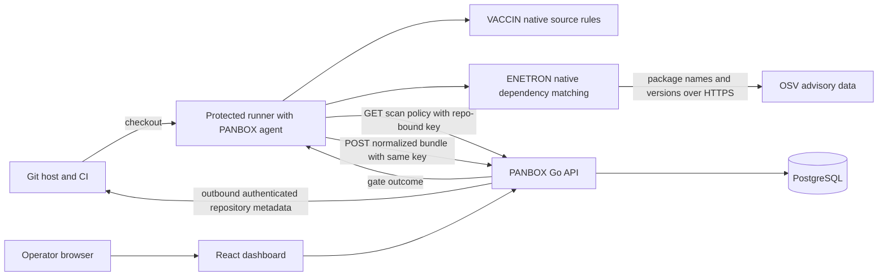

# PANBOX

PANBOX is a lightweight, self-hosted AppSec dashboard and native scanning agent for Git repositories. The Go server serves a React UI and API; PostgreSQL is the only required stateful service. The agent runs on a developer machine or CI runner. It does not execute Semgrep, Grype, or another scanner.

This is an **alpha preview**. VACCIN and ENETRON are first-party PANBOX implementations. VACCIN includes native lexical rules for Java, JavaScript/TypeScript, Python/Django templates, PHP, and Go across injection, unsafe execution, XSS, SSRF, path traversal, deserialization, TLS/cookie controls, cryptography, and risky framework/API usage. Known bundled JavaScript is excluded from VACCIN to reduce noise. ENETRON parses resolved or pinned dependencies from npm, pnpm, Yarn, Bun, Python, Go, Maven/Gradle, and Composer inputs, then matches package versions to OSV advisory data over HTTPS. OSV supplies advisory data, not a scanner executable. If a repo has no supported dependency manifest, ENETRON is marked skipped and a completed VACCIN scan can still pass; malformed or unpinned manifests remain unverified. See the [detection coverage guide](docs/detection-coverage.md) for exact rule themes, manifest support, and limitations.

Release `v0.1.0-alpha.7` added 18 Python and 20 JavaScript/TypeScript checks for direct request-controlled operations and unsafe configuration. Release `v0.1.0-alpha.8` adds clearer CI findings output, ten-row dashboard pagination, latest-scan timestamps, and public remediation references. Release `v0.1.0-alpha.10` adds optional server-side AI review of native findings; scanner rules remain at engine `0.1.5`. Run `panbox version` in CI to verify the agent release and scanner engine. The checks are lexical and have fixture tests; PANBOX has no measured detection or false-positive rate yet.

RIDER (secrets), TESLA (IaC), independent AI vulnerability discovery, approval workflows, executive report templates, and broad language/dataflow coverage are not implemented. Optional AI review of native VACCIN findings is available with GitHub/GitLab source access. Choose a separately billed provider API, or a separate host worker running Codex CLI authenticated with ChatGPT; neither route changes gates. A read-only local MCP bridge and local Codex plugin are available for interactive inspection. See [AI review setup](docs/ai-review.md), the [English guide](docs/product-guide-en.md), and [Indonesian guide](docs/product-guide-id.md).

## How PANBOX works



The runner executes detection. The dashboard controls whether new scans are allowed, which native modules run, and the gate threshold for each repository. The agent reads this policy before each online CI scan; the dashboard does not start a provider's pipeline. A protected runner on the PANBOX LAN is the simplest synchronous path; an SSH relay also supports a synchronous gate without a public PANBOX IP. Artifact pull/import is asynchronous. See [architecture and trust boundaries](docs/architecture.md) for all three routes and the exact data exchanged.

## Dashboard setup

Requirements: Docker Compose with Linux containers. On Debian/Linux or macOS:

```bash
sh scripts/init-local.sh
docker compose --env-file .env -f deploy/docker-compose.yml up -d --build
```

On Windows PowerShell:

```powershell
./scripts/init-local.ps1
docker compose --env-file .env -f deploy/docker-compose.yml up -d --build
```

Open `http://127.0.0.1:8080` or the configured `PANBOX_HOST_PORT`, then sign in with bootstrap credentials from the ignored local `.env`. The dashboard and database bind to loopback by default. Use HTTPS behind a reverse proxy for remote browser access. A local binary server build additionally needs `web/dist`, `migrations/`, and PostgreSQL; the release archives below contain **only the portable agent**.

## Agent binary and scanning

**Pilot controls:** Admin can connect a GitLab service account or GitHub App under **Settings & Audit → SCM connections**. PANBOX tests access, discovers permitted private repositories, and imports up to 500 on save or Sync. The dashboard reads metadata through outbound HTTPS; it does not clone or scan source. Repository rows open detail, edit, pause/resume scan policy, archive/remove, and restore actions. Removed imported repositories are excluded from later sync until Admin allows reimport. The default branch comes from authenticated SCM metadata or, when no connection is available, CI metadata on the first upload; manual override is available. GitHub Enterprise and GitLab self-managed use an HTTPS origin allowlisted in `PANBOX_SCM_ALLOWED_HOSTS`. Configure the random `PANBOX_SCM_ENCRYPTION_KEY` in server `.env` before connecting SCM and back it up with PostgreSQL. Findings retain branch history and become resolved when absent from the next complete scan of their module. Recast and triage actions require an audited reason and revise affected gates. VACCIN reads optional repository-local rules from `.panbox/rules.json`; see the [guides](docs/product-guide-en.md). VACCIN uses bounded lexical signatures, not AST/dataflow analysis; rule accuracy is not independently measured.

The [GitHub Releases page](https://github.com/alterwriter/PANBOX/releases) provides **single agent binaries** for Linux, macOS, and Windows on amd64/arm64, plus checksum-verified installers. Archives remain for manual installs. The dashboard is distributed separately through Docker Compose. No host Node, Python, Semgrep, or Grype installation is needed for the agent.

On a Linux/macOS CI runner, install only the agent into the job workspace at runtime:

```bash
PANBOX_VERSION=v0.1.0-alpha.10
curl -fsSL "https://github.com/alterwriter/PANBOX/releases/download/${PANBOX_VERSION}/install-agent.sh" -o install-panbox-agent.sh
sh install-panbox-agent.sh "$PANBOX_VERSION" .panbox/bin
.panbox/bin/panbox version
.panbox/bin/panbox go --server "$PANBOX_SERVER" --repo "$PANBOX_REPOSITORY_ID" --path .
```

Set `PANBOX_API_KEY` as a protected CI secret with `scans:write`; set `PANBOX_SERVER` to an API address the runner can reach. The installer selects OS/CPU and checks the downloaded binary against release `SHA256SUMS`; it does not need sudo. Existing alpha jobs may pass the API key through `PANBOX_TOKEN`. See the [English](docs/product-guide-en.md) or [Indonesian](docs/product-guide-id.md) guide. To build from source: `go build -o bin/panbox ./cmd/panbox`.

1. For private GitHub/GitLab, Admin opens **Settings & Audit → SCM connections** and connects a GitHub App or GitLab service account with metadata access. PANBOX discovers permitted repositories and enrolls them when auto-enroll is enabled; use Sync when SCM access changes. For other providers or manual setup, open **Repositories → Enroll repository**, enter its stable SCM path, and test metadata. The first authenticated job can supply a default branch when no SCM connection is available. Owner may be blank. PANBOX does not auto-enroll from scan uploads. [Connection and branch details](docs/product-guide-en.md#5-manage-github-and-gitlab-scm-connections).
2. Copy the generated **PANBOX project ID** from the result dialog or Repositories table. It differs from the SCM path. Set CI variable `PANBOX_REPOSITORY_ID` to this ID.
3. Create one ordinary **API key** with `scans:write` in the result dialog or **Settings & Audit -> API & access keys**. Store the one-time secret as protected CI secret `PANBOX_API_KEY`. A project scope is optional; the key owner's repository access remains enforced. No extra repository token is required. Lost key values cannot be retrieved from hashes; use **Rotate** to issue a replacement and revoke the old value. Full [English](docs/product-guide-en.md#6-add-only-the-agent-to-ci) and [Indonesian](docs/product-guide-id.md#6-tambahkan-hanya-agent-ke-ci) walkthroughs cover the first scan.
4. Run:

```bash
panbox ready --server http://127.0.0.1:8080
PANBOX_API_KEY='<api-key>' panbox go --server http://127.0.0.1:8080 --repo '<panbox-project-id>' --path .
```

`panbox go` accepts `--branch`, `--default-branch`, `--commit`, `--base-sha`, `--modules vaccin,enetron`, `--advisory-url`, and `--format text|json|sarif`. It reads the current branch from CI variables or Git and default branch from `PANBOX_DEFAULT_BRANCH`, GitLab `CI_DEFAULT_BRANCH`, or Git remote HEAD. `--offline --output panbox-results.json` writes a bundle without dashboard upload; ENETRON still queries the advisory API unless omitted. A trusted local host can later import the bundle with `PANBOX_API_KEY=... panbox go --server ... --bundle panbox-results.json`.

Each scan reports its own branch, so feature branches appear in Scans, Findings, and filtered Reports once CI runs PANBOX on them. PANBOX does not trigger pipelines itself; the GitLab example runs on protected branches, including protected nondefault branches. The default branch remains the Overview baseline, including when the first scan came from another branch. **Recheck SCM** refreshes auto-detected metadata; connected GitHub/GitLab accounts can verify private repositories. `PANBOX_SCM_ALLOWED_HOSTS` permits metadata checks for self-managed SCM. CI checkout credentials remain on the runner; the dashboard stores only its separate SCM integration credential.

For each **online** scan, the agent authenticates `GET /v1/repos/{id}/scan-config`, scans the enabled modules, then uploads one normalized JSON bundle to `POST /v1/scans` with the same API key in the `Authorization: Bearer` header. The server checks `scans:write`, key scope, key owner access, and project ID; it stores the snapshot and evaluates the gate. Use **Repositories -> Scan policy** to pause scans, enable modules, or set the threshold. Offline scans cannot fetch policy and their later import is checked against current policy.

In **Findings**, select **Recast severity** beside a finding rule to set an effective severity (or restore the scanner value) with an audited reason. The button needs `findings:recast` and repository access; if no rows appear, complete the first scan or clear filters. Raw severity never changes; affected historic gate revisions are recalculated against their original thresholds. **Reports** exports the latest complete snapshots as CSV, JSON, or PDF, filtered by repository, branch, scan module, and severity. The PDF is a readable technical summary; CSV/JSON retain the full row data.

For an MCP host, generate a read-only **Access key** with `repos:read`, `scans:read`, and `findings:read` in **Settings & Audit -> API & access keys**. In **Settings & Audit -> MCP setup**, copy the generic stdio configuration for `panbox mcp`; set `PANBOX_SERVER` and `PANBOX_TOKEN` in the MCP host's secret environment. The bridge exposes read-only repositories, findings, and scans and uses the API's RBAC and repository scope.

For Codex, the repo also includes a [local PANBOX plugin](plugins/panbox/plugin.json) and marketplace entry. It wraps the same read-only MCP bridge. Installing the plugin does not start automatic review; the optional [Codex host worker](docs/ai-review.md#codex-plan-route-no-provider-api-key) does that after CI upload.

Exit codes: `0` complete/pass, `1` complete/gate fail, `2` error or unverified/partial, `3` authentication/authorization rejected. The dashboard preserves the last successful snapshot when a scan is partial. Scans with no supported pinned dependency manifest do not silently pass ENETRON.

## Public SCM to private PANBOX

The repository can be public while PANBOX has no public IP or domain. These transport patterns are independent of the Git host:

| Path | Inbound to PANBOX host | Synchronous CI gate | Example |
|---|---|---|---|
| Hosted SCM runner to a public HTTPS PANBOX endpoint | HTTPS 443 | Yes | `deploy/github-actions-local-runner.yml`, `deploy/gitlab-ci-local-runner.yml` |
| Reverse SSH tunnel from PANBOX to a reachable relay, plus a forward tunnel from CI | None | Yes | `deploy/gitlab-ci-ssh-relay.yml` |
| CI artifact fetched and imported by PANBOX host | None | No | `deploy/gitlab-ci-pull-artifact.yml` (GitLab API), or any SCM artifact download followed by `panbox go --bundle` |

The hosted-runner templates target a PANBOX API reachable over HTTPS. Protect the API key and never expose it to untrusted pull request code. If PANBOX stays private, use the SSH relay: pin host keys and restrict both SSH identities. The relay must be publicly reachable, while PANBOX itself needs no inbound route. Artifact pull is asynchronous and cannot enforce a CI gate; the included automated pull implementation currently covers GitLab, while bundle import works with artifacts from any SCM.

## Access control and resources

`admin` is the highest immutable role. Admins can create custom roles with explicit permissions, assign users, and grant repository membership. API and read-only access keys can be scoped to permissions and a repository. Scan keys are write-only for one repository. Keys expire, are revocable, and are stored as hashes.

The dashboard target is a 2 GB Debian host, but this remains an unverified sizing target. The dashboard does not run scan jobs. Agent source checks skip source files above 2 MiB; ENETRON processes up to 20,000 pinned dependencies per scan in batches, follows OSV pagination, and fetches advisory details. Measure memory/CPU and request volume on representative repositories before making a performance claim.

## Verify

```bash
go test ./...
cd web && npm ci && npm run build
```

Integration tests use a separate PostgreSQL database when `PANBOX_TEST_DATABASE_URL` is set. Start with the [documentation index](docs/README.md) for setup, architecture, integration, API, and release guides.
