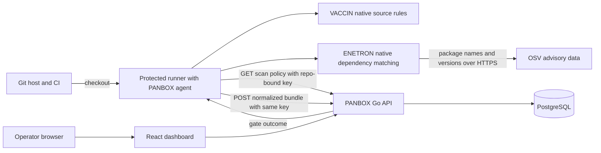

# PANBOX

PANBOX is a lightweight, self-hosted AppSec dashboard and native scanning agent for Git repositories. The Go server serves a React UI and API; PostgreSQL is the only required stateful service. The agent runs on a developer machine or CI runner. It does not execute Semgrep, Grype, or another scanner.

This is an **alpha preview**. VACCIN and ENETRON are first-party PANBOX implementations with deliberately narrow coverage. VACCIN checks selected Python, JavaScript/TypeScript, and Go source patterns. ENETRON reads pinned npm lockfiles (v2/v3), `requirements.txt`, and `go.mod`, then matches package versions to OSV advisories through the OSV API. OSV supplies advisory data, not a scanner executable. Missing manifests or advisory service failure mark the ENETRON module as error, so the gate is unverified. An advisory without usable severity is reported as `info`. The agent sends package names and versions to the configured advisory endpoint; use `PANBOX_ADVISORY_URL` for an approved OSV-compatible mirror.

RIDER (secrets), TESLA (IaC), AI, approval workflows, executive report templates, and broad language/dataflow coverage are not implemented. A read-only local MCP bridge is available. See the detailed [English guide](docs/product-guide-en.md) and [Indonesian guide](docs/product-guide-id.md).

## How PANBOX works



The runner executes detection. The dashboard controls whether new scans are allowed, which native modules run, and the gate threshold for each repository. The agent reads this policy before each online CI scan; the dashboard does not start a provider's pipeline. A protected runner on the PANBOX LAN is the simplest synchronous path; an SSH relay also supports a synchronous gate without a public PANBOX IP. Artifact pull/import is asynchronous. See [architecture and trust boundaries](docs/architecture.md) for all three routes and the exact data exchanged.

## Dashboard setup

Requirements: Docker Compose with Linux containers. On Debian/Linux or macOS:

```bash
sh scripts/init-local.sh
docker compose --env-file .env -f deploy/docker-compose.yml up -d --build
```

On Windows PowerShell:

```powershell
./scripts/init-local.ps1
docker compose --env-file .env -f deploy/docker-compose.yml up -d --build
```

Open `http://127.0.0.1:8080` or the configured `PANBOX_HOST_PORT`, then sign in with bootstrap credentials from the ignored local `.env`. The dashboard and database bind to loopback by default. Use HTTPS behind a reverse proxy for remote browser access. A local binary server build additionally needs `web/dist`, `migrations/`, and PostgreSQL; the release archives below contain **only the portable agent**.

## Agent binary and scanning

The [GitHub Releases page](https://github.com/alterwriter/PANBOX/releases) provides **single agent binaries** for Linux, macOS, and Windows on amd64/arm64, plus checksum-verified installers. Archives remain for manual installs. The dashboard is distributed separately through Docker Compose. No host Node, Python, Semgrep, or Grype installation is needed for the agent.

On a Linux/macOS CI runner, install only the agent into the job workspace at runtime:

```bash
PANBOX_VERSION=v0.1.0-alpha.5
curl -fsSL "https://github.com/alterwriter/PANBOX/releases/download/${PANBOX_VERSION}/install-agent.sh" -o install-panbox-agent.sh
sh install-panbox-agent.sh "$PANBOX_VERSION" .panbox/bin
.panbox/bin/panbox go --server "$PANBOX_SERVER" --repo "$PANBOX_REPOSITORY_ID" --path .
```

Set `PANBOX_TOKEN` as a protected CI secret and `PANBOX_SERVER` to an API address the runner can reach. The installer selects OS/CPU and checks the downloaded binary against release `SHA256SUMS`; it does not need sudo. See the [English](docs/product-guide-en.md) or [Indonesian](docs/product-guide-id.md) guide for server setup, Windows, and transport choices. To build from source: `go build -o bin/panbox ./cmd/panbox`.

1. Before the first scan, open **Repositories -> Enroll repository**. Choose the SCM provider (GitHub, GitLab, Bitbucket, Azure Repos, Gitea, or Other Git), then enter a display name, stable SCM repository path/ID (for example `alterwriter/PANBOX`), and default branch. This registers a PANBOX record; it does not clone the source. PANBOX does not auto-enroll repositories from a scan.
2. Copy the generated **PANBOX ID for CI** from the result dialog or Repositories table. This internal ID differs from the SCM path. Set CI variable `PANBOX_REPOSITORY_ID` to the internal ID.
3. Generate a repository-bound **scan key** from that row, requiring `tokens:manage`, `scans:write`, and repository access. Store the one-time secret as protected CI secret `PANBOX_TOKEN`, and set `PANBOX_SERVER` to an API URL reachable from the runner. The server checks the token's repository binding; Git remote text is never trusted as authorization. Full [English](docs/product-guide-en.md#5-add-only-the-agent-to-ci) and [Indonesian](docs/product-guide-id.md#5-tambahkan-hanya-agent-ke-ci) walkthroughs cover the first scan and validation.
4. Run:

```bash
panbox ready --server http://127.0.0.1:8080
PANBOX_TOKEN='<scan-key>' panbox go --server http://127.0.0.1:8080 --repo '<internal-id>' --path .
```

`panbox go` accepts `--branch`, `--commit`, `--base-sha`, `--modules vaccin,enetron`, `--advisory-url`, and `--format text|json|sarif`. It reads branch names from common GitHub, GitLab, Bitbucket, and Azure CI variables, then falls back to Git. `--offline --output panbox-results.json` writes a bundle without uploading it; **offline refers only to dashboard delivery**. ENETRON still queries the advisory API unless omitted with `--modules vaccin`. An offline bundle may later be imported on a trusted local host with `PANBOX_TOKEN=... panbox go --server ... --bundle panbox-results.json`.

For each **online** scan, the agent authenticates `GET /v1/repos/{id}/scan-config`, scans the enabled modules, then uploads one normalized JSON bundle to `POST /v1/scans` with the same scan key in the `Authorization: Bearer` header. The server checks the repository binding, stores the snapshot, evaluates the configured gate threshold, and returns the verdict. The agent maps it to its process exit code. Use **Repositories -> Scan policy** to pause scans, enable modules, or set the gate threshold. `--modules` may narrow the enabled set, but cannot enable a module disabled by the dashboard. Offline scans cannot fetch policy and their later import is checked against the current server policy.

In **Findings**, select **Recast severity** beside a finding rule to set an effective severity (or restore the scanner value) with an audited reason. The button needs `findings:recast` and repository access; if no rows appear, complete the first scan or clear filters. Raw severity never changes; affected historic gate revisions are recalculated against their original thresholds. **Reports** exports the latest complete snapshots as CSV, JSON, or PDF, filtered by repository, branch, scan module, and severity. The PDF is a readable technical summary; CSV/JSON retain the full row data.

For an MCP host, generate a read-only **Access key** with `repos:read`, `scans:read`, and `findings:read` in **Settings & Audit -> API & access keys**. In **Settings & Audit -> MCP setup**, copy the generic stdio configuration for `panbox mcp`; set `PANBOX_SERVER` and `PANBOX_TOKEN` in the MCP host's secret environment. The bridge exposes read-only repositories, findings, and scans and uses the API's RBAC and repository scope.

Exit codes: `0` complete/pass, `1` complete/gate fail, `2` error or unverified/partial, `3` authentication/authorization rejected. The dashboard preserves the last successful snapshot when a scan is partial. Scans with no supported pinned dependency manifest do not silently pass ENETRON.

## Public SCM to private PANBOX

The repository can be public while PANBOX has no public IP or domain. These transport patterns are independent of the Git host:

| Path | Inbound to PANBOX host | Synchronous CI gate | Example |
|---|---|---|---|
| Protected self-hosted runner on the PANBOX LAN | None | Yes | `deploy/github-actions-local-runner.yml`, `deploy/gitlab-ci-local-runner.yml` |
| Reverse SSH tunnel from PANBOX to a reachable relay, plus a forward tunnel from CI | None | Yes | `deploy/gitlab-ci-ssh-relay.yml` |
| CI artifact fetched and imported by PANBOX host | None | No | `deploy/gitlab-ci-pull-artifact.yml` (GitLab API), or any SCM artifact download followed by `panbox go --bundle` |

A local runner polls the SCM over outbound HTTPS and posts scan results to PANBOX on its private network. Protect the runner, branch, and scan key; do not run untrusted pull request code with a scan key. For an SSH relay, pin host keys and restrict both SSH identities. The relay must be publicly reachable, while PANBOX itself needs no inbound route. Artifact pull is asynchronous and cannot enforce a CI gate; the included automated pull implementation currently covers GitLab, while the bundle import works with artifacts from any SCM.

## Access control and resources

`admin` is the highest immutable role. Admins can create custom roles with explicit permissions, assign users, and grant repository membership. API and read-only access keys can be scoped to permissions and a repository. Scan keys are write-only for one repository. Keys expire, are revocable, and are stored as hashes.

The dashboard target is a 2 GB Debian host, but this remains an unverified sizing target. The dashboard does not run scan jobs. Agent source checks have bounded file sizes; ENETRON limits a scan to 500 pinned dependencies and calls an advisory API. Measure memory/CPU on the intended host with representative repositories before making a performance claim.

## Verify

```bash
go test ./...
cd web && npm ci && npm run build
```

Integration tests use a separate PostgreSQL database when `PANBOX_TEST_DATABASE_URL` is set. Start with the [documentation index](docs/README.md) for setup, architecture, integration, API, and release guides.
