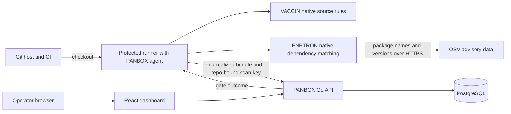

# PANBOX

PANBOX is a lightweight, self-hosted AppSec dashboard and native scanning agent for Git repositories. The Go server serves a React UI and API; PostgreSQL is the only required stateful service. The agent runs on a developer machine or CI runner. It does not execute Semgrep, Grype, or another scanner.

This is an **alpha preview**. VACCIN and ENETRON are first-party PANBOX implementations with deliberately narrow coverage. VACCIN checks selected Python, JavaScript/TypeScript, and Go source patterns. ENETRON reads pinned npm lockfiles (v2/v3), `requirements.txt`, and `go.mod`, then matches package versions to OSV advisories through the OSV API. OSV supplies advisory data, not a scanner executable. Missing manifests or advisory service failure mark the ENETRON module as error, so the gate is unverified. An advisory without usable severity is reported as `info`. The agent sends package names and versions to the configured advisory endpoint; use `PANBOX_ADVISORY_URL` for an approved OSV-compatible mirror.

RIDER (secrets), TESLA (IaC), AI, MCP, advanced report templates, and broad language/dataflow coverage are not implemented. See the detailed [English guide](docs/product-guide-en.md) and [Indonesian guide](docs/product-guide-id.md).

## How PANBOX works



The runner executes detection; the dashboard stores and presents results. PANBOX stays on a private host. A protected runner on its LAN is the simplest synchronous path; an SSH relay also supports a synchronous gate without a public PANBOX IP. Artifact pull/import is asynchronous. See [architecture and trust boundaries](docs/architecture.md) for all three routes and the exact data exchanged.

## Dashboard setup

Requirements: Docker Compose with Linux containers. On Debian/Linux or macOS:

```bash
sh scripts/init-local.sh
docker compose --env-file .env -f deploy/docker-compose.yml up -d --build
```

On Windows PowerShell:

```powershell
./scripts/init-local.ps1
docker compose --env-file .env -f deploy/docker-compose.yml up -d --build
```

Open `http://127.0.0.1:8080` or the configured `PANBOX_HOST_PORT`, then sign in with bootstrap credentials from the ignored local `.env`. The dashboard and database bind to loopback by default. Use HTTPS behind a reverse proxy for remote browser access. A local binary server build additionally needs `web/dist`, `migrations/`, and PostgreSQL; the release archives below contain **only the portable agent**.

## Agent binary and scanning

The [GitHub Releases page](https://github.com/alterwriter/PANBOX/releases) provides Linux, macOS, and Windows agent archives for amd64 and arm64, plus `SHA256SUMS`. Download the archive matching the runner, verify its SHA-256 against `SHA256SUMS`, extract `panbox` (or `panbox.exe`), and put it on `PATH`. To build from source: `go build -o bin/panbox ./cmd/panbox`. No host Node, Python, Semgrep, or Grype installation is needed for the agent.

1. In **Repositories**, choose the SCM provider (GitHub, GitLab, Bitbucket, Azure Repos, Gitea, or Other Git) and enter its stable repository ID/path. PANBOX assigns a separate internal repository ID.
2. Generate a repository-bound **scan key**. Store it as CI secret `PANBOX_TOKEN`, and set `PANBOX_REPOSITORY_ID` to the PANBOX ID. The server checks the token's repository binding; Git remote text is never trusted as authorization.
3. Run:

```bash
panbox ready --server http://127.0.0.1:8080
PANBOX_TOKEN='<scan-key>' panbox go --server http://127.0.0.1:8080 --repo '<internal-id>' --path .
```

`panbox go` accepts `--branch`, `--commit`, `--base-sha`, `--modules vaccin,enetron`, `--advisory-url`, and `--format text|json|sarif`. It reads branch names from common GitHub, GitLab, Bitbucket, and Azure CI variables, then falls back to Git. `--offline --output panbox-results.json` writes a bundle without uploading it; **offline refers only to dashboard delivery**. ENETRON still queries the advisory API unless omitted with `--modules vaccin`. An offline bundle may later be imported on a trusted local host with `PANBOX_TOKEN=... panbox go --server ... --bundle panbox-results.json`.

Exit codes: `0` complete/pass, `1` complete/gate fail, `2` error or unverified/partial, `3` authentication/authorization rejected. The dashboard preserves the last successful snapshot when a scan is partial. Scans with no supported pinned dependency manifest do not silently pass ENETRON.

## Public SCM to private PANBOX

The repository can be public while PANBOX has no public IP or domain. These transport patterns are independent of the Git host:

| Path | Inbound to PANBOX host | Synchronous CI gate | Example |
|---|---|---|---|
| Protected self-hosted runner on the PANBOX LAN | None | Yes | `deploy/github-actions-local-runner.yml`, `deploy/gitlab-ci-local-runner.yml` |
| Reverse SSH tunnel from PANBOX to a reachable relay, plus a forward tunnel from CI | None | Yes | `deploy/gitlab-ci-ssh-relay.yml` |
| CI artifact fetched and imported by PANBOX host | None | No | `deploy/gitlab-ci-pull-artifact.yml` (GitLab API), or any SCM artifact download followed by `panbox go --bundle` |

A local runner polls the SCM over outbound HTTPS and posts scan results to PANBOX on its private network. Protect the runner, branch, and scan key; do not run untrusted pull request code with a scan key. For an SSH relay, pin host keys and restrict both SSH identities. The relay must be publicly reachable, while PANBOX itself needs no inbound route. Artifact pull is asynchronous and cannot enforce a CI gate; the included automated pull implementation currently covers GitLab, while the bundle import works with artifacts from any SCM.

## Access control and resources

`admin` is the highest immutable role. Admins can create custom roles with explicit permissions, assign users, and grant repository membership. API and read-only access keys can be scoped to permissions and a repository. Scan keys are write-only for one repository. Keys expire, are revocable, and are stored as hashes.

The dashboard target is a 2 GB Debian host, but this remains an unverified sizing target. The dashboard does not run scan jobs. Agent source checks have bounded file sizes; ENETRON limits a scan to 500 pinned dependencies and calls an advisory API. Measure memory/CPU on the intended host with representative repositories before making a performance claim.

## Verify

```bash
go test ./...
cd web && npm ci && npm run build
```

Integration tests use a separate PostgreSQL database when `PANBOX_TEST_DATABASE_URL` is set. The API contract is in `api/openapi.yaml`. Historical blueprint decisions are recorded in `docs/PANBOX-blueprint-v1.md`; this README reflects the current native-only direction.
