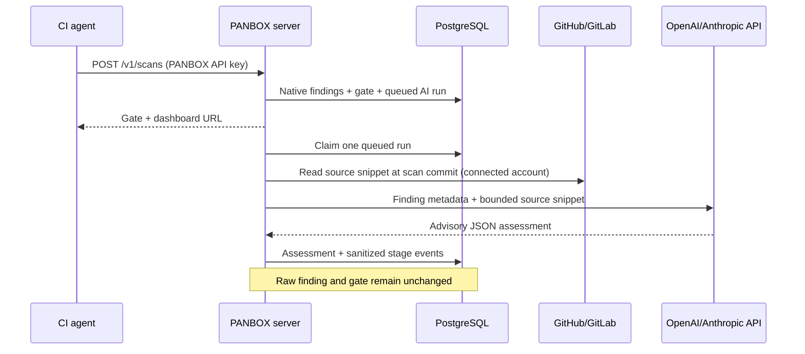

# Server-side AI review (beta)

PANBOX keeps VACCIN and ENETRON detection in the CI agent. An optional worker inside `panbox-server` reviews a bounded subset of VACCIN findings **after** the scan bundle and gate have been stored. CI does not run Codex or Claude and never waits for the AI result. The AI result is a suggestion, not an independent vulnerability discovery, false-positive measurement, disposition, recast, or gate input.

## Configure

1. In **Settings & Audit → GitHub & GitLab connections**, connect the repository. The GitHub App needs repository **Metadata: read** for discovery and **Contents: read** for AI source fetch. A GitLab service account token with `read_api` can discover repositories and read repository files through the GitLab API; restrict its project membership. Restrict it to the intended projects; self-hosted HTTPS hosts still require `PANBOX_SCM_ALLOWED_HOSTS`.
2. Put one provider secret on the **PANBOX server**, in its ignored `.env` or secret manager: `PANBOX_OPENAI_API_KEY` for an OpenAI coding model, or `PANBOX_ANTHROPIC_API_KEY` for a Claude model. `deploy/docker-compose.yml` passes these through to the server container. Restart the server after changing environment secrets. The browser and CI do not receive these keys.
3. As Admin, open **Settings & Audit → Server-side AI review → Configure and view runs**. Select provider, enter an available model ID for your account, set 1–10 findings per scan (default 3), and enable. The key presence indicator must read configured. Enable only after approving transfer of private source snippets to that provider.
4. Upload a new scan with the ordinary CI agent. The worker queues automatically. For an older scan, open **Scans → scan detail → Queue AI review on server**. No CI variable or job changes are required.
5. Open **Configure and view runs** to inspect queued/running/completed/partial/failed status, timestamped process events, source access failures, and each finding's verdict, confidence, explanation, evidence, and suggested fix. Events contain stage/status, not raw source, provider prompts, credentials, or model reasoning traces.

The worker selects at most the configured number of Critical, High, then Medium VACCIN occurrences with a source path. It reads a small window around each finding line at the exact scanned commit, caps source size, and sends only that window plus finding metadata to the chosen provider over HTTPS. It processes one run at a time per server process. API calls have timeouts and are bounded by the 100-second run deadline; failed reviews are visible as partial/failed runs. A restart can reclaim an interrupted run after its lease ages out. Source permission or provider failures never turn a previously completed scan into a failed CI job.

AI assessments are stored under their run and finding IDs. They do not rewrite scanner severity, close findings, or revise gates. A human must use normal triage/recast controls with an audited reason. The model can be mistaken; verify the source and rerun native scanning after a fix. PANBOX does not execute model-suggested commands or write to the SCM.

The existing `panbox mcp` stdio bridge is a separate, read-only way for an interactive Codex or Claude session to inspect PANBOX data with a scoped Access key. Connecting PANBOX as an MCP server does **not** trigger the server worker. Automatic review uses the configured model provider API on the PANBOX host.
