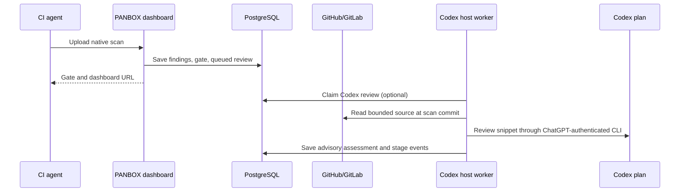

# Optional AI review (beta)

The native CI agent uploads VACCIN/ENETRON findings and receives the gate immediately. AI review then checks up to the Admin-selected number of existing Critical/High/Medium VACCIN findings. It is advisory: it cannot change findings, severity, dispositions, or gates, and it does not discover new vulnerabilities independently.

## Codex plan route: no provider API key

Run the optional `panbox-ai-worker` **on the trusted PANBOX host**, outside the lightweight dashboard Docker container and outside CI. Install the [Codex CLI](https://learn.chatgpt.com/docs/codex/cli) and sign in with ChatGPT as the dedicated OS user that runs the worker. On a headless server, run `codex login --device-auth`, open the URL printed by Codex in a browser, enter its one-time code, and verify `codex login status` says `Logged in using ChatGPT`. Device authentication may need to be enabled in the ChatGPT account or workspace. The worker starts even before login, reports `login_required`, and waits to claim queued reviews until login is ready. It checks login again before each review and rejects API-key login. This route uses that account's Codex plan allowance or applicable credits. It does not use `PANBOX_OPENAI_API_KEY`, `PANBOX_ANTHROPIC_API_KEY`, or a provider API key. A plugin or MCP connection alone does not start automatic reviews.

PANBOX Admin cannot initiate the host CLI login through an ordinary ChatGPT website redirect. The login belongs to the OS account running Codex CLI. The dashboard separately shows worker **online/offline** from its heartbeat and ChatGPT login **ready/required** from the host's local Codex status. These do not describe an interactive MCP client's login. PANBOX never receives the ChatGPT password or browser auth token. If login expires, the worker stays online but pauses new queued reviews until it is restored; an in-flight review can fail with a visible process error.

1. Connect the repository in **Settings & Audit → GitHub & GitLab connections**. The GitHub App needs `Metadata: read` and `Contents: read`; a GitLab service account needs `read_api` on permitted projects. PANBOX fetches a bounded snippet at the exact scan commit.
2. Keep PostgreSQL on loopback. The Compose file already maps it to `127.0.0.1:5434` by default. Give the worker its own private environment file with `DATABASE_URL` pointing to that port, the **same** `PANBOX_SCM_ENCRYPTION_KEY` as the dashboard, and `PANBOX_MIGRATIONS_DIR` pointing to this checkout's `migrations` folder. Protect the file for the worker OS user. The worker has database and SCM-read authority; do not run it on a public runner.
3. Download the `panbox-ai-worker_<os>_<arch>` binary (`.exe` on Windows) from the [same PANBOX release](https://github.com/alterwriter/PANBOX/releases) as the dashboard, or build it with `go build -o panbox-ai-worker ./cmd/panbox-ai-worker`. Keep `codex` on that user's `PATH`. For Debian/Linux, adapt the [systemd unit](../deploy/panbox-ai-worker.service.example), save it as `/etc/systemd/system/panbox-ai-worker.service`, run `sudo systemctl daemon-reload && sudo systemctl enable --now panbox-ai-worker`, and inspect `systemctl status panbox-ai-worker`. On Windows/macOS, run the same binary with these environment variables using the native service manager; no PowerShell-specific initialization is required.
4. As Admin, open **Settings & Audit → Server-side AI review**. Confirm both **worker online** and **ChatGPT login ready**. Choose **Codex CLI · ChatGPT login**, leave Model ID blank to use the local CLI default, set 1–10 findings per scan (default 3), and enable. Queued reviews wait while the worker is offline or login is required. Existing scans can be queued from scan detail.
5. Watch **Recent server runs** for queued/running/completed/partial/failed status, timestamped stages, and each verdict, confidence, explanation, evidence, and suggested fix. Open a finding to see its current AI evaluation state and advisory. Stage events omit raw source, prompts, credentials, and model reasoning traces.

| Finding AI state | Meaning |
|---|---|
| Not requested | No review was queued for its latest complete scan. |
| Queued / Reviewing | The selected run is waiting / executing. Refresh the finding after completion. |
| Reviewed | The latest run saved a verdict, confidence, evidence, explanation, and suggested fix. |
| Not reviewed | A run finished without assessing this finding, such as when the per-scan cap was reached. |
| Review failed | The latest run failed; inspect its error code and Admin process log. |
| Not eligible | Outside the supported open Critical/High/Medium VACCIN source-line selection. |
| Not in latest scan / Historical scan | The finding is resolved on the latest complete branch scan / the list row belongs to an older scan. |

AI evaluations are advisory and never change the native gate, finding disposition, or severity.

The worker uses `codex exec --ephemeral --sandbox read-only` with a structured JSON output schema. It passes only finding metadata and a bounded, redacted source window via stdin. The Codex child process receives a minimal environment without PANBOX database, SCM, or provider API secrets. Use a dedicated OS account and dedicated Codex login so its readable files and quota are isolated. The worker processes one review run at a time; each run has a five-minute deadline. An interruption can be reclaimed after six minutes. A failed AI review never turns a completed CI scan into a failed job.

## Interactive Codex plugin or MCP

The repo includes a [local Codex plugin](../plugins/panbox/plugin.json) and [marketplace entry](../.agents/plugins/marketplace.json). It wraps the **read-only** `panbox mcp` stdio bridge. Install the PANBOX agent binary on the Codex host's `PATH`; set `PANBOX_SERVER` and a scoped `PANBOX_TOKEN` access key (`repos:read`, `scans:read`, `findings:read`) in the Codex process's protected environment. Run `codex plugin marketplace add alterwriter/PANBOX --ref v0.1.0-alpha.12`, start Codex, enter `/plugins`, choose **PANBOX Local**, install **PANBOX**, then start a new session and enter `/mcp`. Alternatively configure the same STDIO command in ChatGPT desktop **Settings → MCP servers → Add server**. ChatGPT web does not load a local Codex config or STDIO process. The plugin does not grant source checkout, write findings, or trigger the automatic worker. Do not put PANBOX tokens into plugin JSON or Git.

## Provider API route (optional)

The existing dashboard worker can instead use `PANBOX_OPENAI_API_KEY` or `PANBOX_ANTHROPIC_API_KEY` configured on the server and the corresponding model ID selected by Admin. This path is **separately billed by that provider**. Private source snippets leave the PANBOX host for the selected provider when enabled. It uses the same bounded finding selection and advisory storage. To avoid separate provider API usage, leave these keys unset and select the Codex route.
