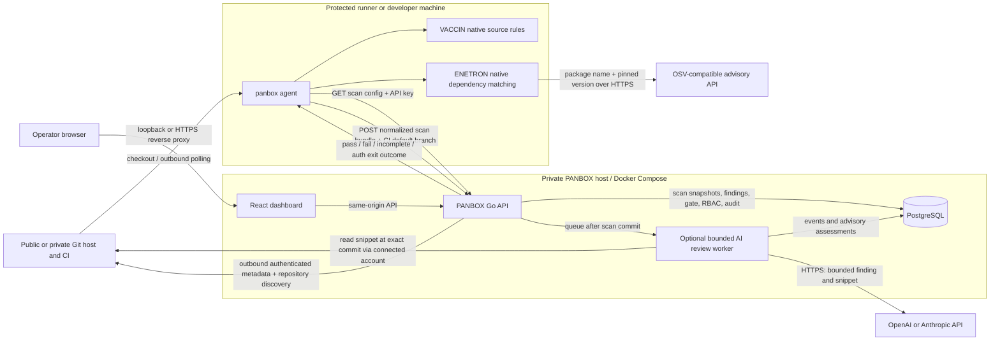
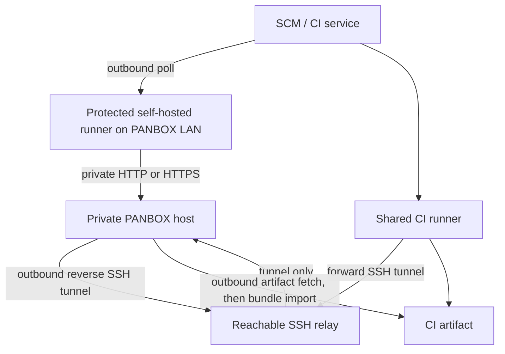

# PANBOX architecture

This diagram describes the beta implementation. The dashboard is a small self-hosted control plane; scan work runs on a separate machine or CI runner. A GitHub, GitLab, Bitbucket, Azure Repos, Gitea, or other Git host can provide the checkout. PANBOX authorizes uploads with a PANBOX project ID, an API key with `scans:write`, and repository access.

## What crosses each boundary

Repository enrollment records the provider, SCM path, HTTPS origin, owner label, and default branch source (`auto`, `ci_pending`, `ci`, or `manual`). Admin can connect a GitLab service account (`read_api`) or GitHub App (repository metadata read) in Settings. Provider credentials are encrypted with `PANBOX_SCM_ENCRYPTION_KEY` in PostgreSQL and never sent to runners. A connected account discovers up to 500 permitted repositories per sync and auto-enrolls them when enabled. The metadata preflight uses an exact-host allowlist for self-hosted SCM. An API key may be project-scoped or valid across its owner's allowed projects; archived projects block upload and their project-bound keys are revoked. The VACCIN runner loads optional repository-local `.panbox/rules.json` with bounded Go regular expressions; a malformed file fails the module. Source stays on the runner. The API stores normalized findings and occurrences, then calculates branch state from the latest complete scan of the finding's module. Recast and disposition histories create new gate revisions without rewriting raw evidence. Only active, open findings contribute to posture totals; resolved findings remain queryable.

VACCIN engine `0.1.5` runs native bounded lexical signatures over supported files, including 18 additional Python and 20 JavaScript/TypeScript checks in `v0.1.0-alpha.7`. It strips comments and uses a literal-preserving view only for rules that inspect configuration values. It does not build an AST or follow values across functions. The agent embeds its release tag at build time; `panbox version` prints that tag and the scanner engine version, allowing CI logs to identify which rule set produced a scan.

From `v0.1.0-alpha.8`, the repository API also reports the most recent scan time across branches. The dashboard pages loaded repository, finding, and scan rows in groups of ten; pilot list responses retain their existing limits of 100 scans and 1,000 findings. SAST detail shows file and line, a link to the scanned commit when SCM metadata permits it, a fix suggestion, and a curated public OWASP or Django reference. ENETRON links to its OSV advisory. Reference sites receive no finding or source payload merely because PANBOX displays a link. The CLI prints a compact CI summary and a collapsible GitLab finding section; its machine-readable JSON and SARIF outputs remain separate.

1. Admin connects a GitLab service account or GitHub App, tests it, and imports the accessible repository list on save or explicit Sync. This is outbound HTTPS from the PANBOX host; no public PANBOX address is required. Admin can edit/disable/delete connections, pause scans, edit repositories, remove or restore them, and allow reimport of deliberately removed repositories. Manual enrollment still works for every supported provider. Connected metadata supplies private default branches; without a connection, private or unreachable metadata leaves `ci_pending`, and the first authenticated CI job can supply the branch even while scanning a feature branch. Self-managed Git hosts need their exact HTTPS host in `PANBOX_SCM_ALLOWED_HOSTS`. The API creates a PANBOX project ID; an authorized manager creates an API key with `scans:write`. Owner is display metadata. PANBOX never clones source or auto-enrolls from uploads.
2. The agent checks selected source patterns with VACCIN and pinned dependency manifests with ENETRON. ENETRON sends **package names and versions** to the configured OSV-compatible advisory API over HTTPS. It does not send source files to that advisory endpoint. The alpha needs that advisory API for ENETRON; `--offline` suppresses dashboard upload only.
3. Before an online scan, the agent sends `GET /v1/repos/{project-id}/scan-config` with `Authorization: Bearer <api-key>`. The server checks `scans:write`, optional key project scope, key owner membership or Admin, and project active state. Offline scans skip this fetch and are checked when imported.
4. The agent sends a normalized JSON bundle to `POST /v1/scans` with the same header. It contains repository/branch/commit identity, module status, rule IDs, severities, paths/lines, and short messages. It does not contain raw source snippets. The server checks module permissions again, writes the snapshot, and returns a gate result. A partial or error scan is unverified and does not replace the last successful posture. When Admin enables AI review, the server also queues a separate run after the scan commit; CI does not wait for it.
5. The Go API stores scan policies, scans, findings, severity recast history, gate revisions, roles/permissions, key hashes, and audit events in PostgreSQL. Operators configure scan policy in Repositories, recast findings in Findings, and export filtered CSV/JSON/PDF from Reports. A recast updates effective severity on occurrences and recalculates affected gate revisions using each scan's original threshold; raw severity remains intact.
6. The browser reaches the dashboard on loopback by default. Remote browser access needs a private route or an HTTPS reverse proxy. PostgreSQL should remain private. A local `panbox mcp` stdio process on the Codex host exposes read-only API data using a scoped access key; its ChatGPT login is local to that host and invisible to PANBOX. Automatic AI review has two optional execution routes: the lightweight dashboard process calls a configured provider API, or a separate `panbox-ai-worker` on the trusted PANBOX host invokes ChatGPT-authenticated Codex CLI. The dashboard's online/offline indicator is a worker heartbeat, not the interactive MCP client's login state. Both routes read bounded source snippets through the connected GitHub/GitLab credential and store advisory output and sanitized stage events. See [AI review](ai-review.md) for configuration and limits.

Each uploaded bundle carries its current branch and optionally the SCM default branch from trusted CI metadata. Feature branches appear separately without reenrollment. The enrolled default branch drives Overview posture; when enrollment was `ci_pending`, CI metadata establishes that baseline without assuming the scanned branch is default. Later CI metadata refreshes CI-sourced defaults; a manual override remains authoritative. Runner-to-PANBOX connectivity and API key authorization are checked separately through `/readyz` and `/v1/repos/{id}/scan-config` from the runner.

## Public CI to a dashboard without a public IP

| Mode | Where the agent runs | Inbound port on PANBOX host | Gate in the CI job | Current automation |
|---|---|---|---|---|
| Local protected runner | Inside LAN/private network | None from the internet | Synchronous | GitHub Actions and GitLab examples |
| SSH relay | Shared CI runner | None from the internet; outbound reverse tunnel | Synchronous | GitLab example; topology works with other SCM CI |
| Artifact pull/import | CI runner produces bundle; local host imports | None | Asynchronous only | GitLab `relay-pull`; other SCM artifacts need a provider download step before generic `--bundle` import |

The SSH relay is an internet-reachable intermediary, not a public PANBOX endpoint. It needs pinned host keys and restricted identities. A local runner is the simplest path when it can reach both the SCM over outbound HTTPS and PANBOX over the private network. The artifact path is useful when neither CI nor a relay can connect to PANBOX, but it cannot block the originating CI pipeline based on the later dashboard gate.

## Deployment boundary and resource behavior

`deploy/docker-compose.yml` runs the Go server and PostgreSQL. The server serves the built React UI and API; it does not invoke the agent. Each CI job can fetch a pinned, agent-only binary from GitHub Releases into its workspace, verify `SHA256SUMS`, scan, and discard the binary with the job. The dashboard host does not distribute or install agent binaries. Server and database bind to host loopback by default. The 2 GB host target remains a sizing hypothesis, not a measured production guarantee; benchmark both the dashboard and runner with representative repositories and scan bundles.

VACCIN ships first-party lexical source signatures for Java/JSP, JavaScript/TypeScript, Python/Django templates, PHP, and Go. Current families include injection, unsafe execution/deserialization, XSS, SSRF, traversal, TLS/cookie controls, cryptography, and risky framework/API use. The runner checks Django settings, Python call sites, and HTML files below `templates/`; it excludes known bundled JavaScript under `static/` and `assets/` to reduce noise. It does not perform compiler-backed AST or interprocedural taint analysis, and no false-positive rate has been measured. ENETRON reads npm, pnpm, Yarn, Bun JSON, Python requirements/Pipfile/Poetry/uv/PDM, Go `go.mod`/`go.sum`, Maven `pom.xml`, Gradle `gradle.lockfile`, and Composer lock inputs, then queries OSV-compatible advisory data in bounded, paginated batches. When no supported dependency manifest is present, ENETRON is recorded as skipped and completed VACCIN checks can still produce a verified scan. Malformed or unpinned manifests and advisory-service failures remain errors. Feature branches are scanned; their first report may show an unknown baseline until a prior branch/base scan exists. Maven properties, imported BOMs, parent-POM inheritance, and full transitives are not resolved. RIDER secret scanning and TESLA IaC scanning are roadmap items. See [detection coverage](detection-coverage.md), the [English guide](product-guide-en.md), and the [Indonesian guide](product-guide-id.md) for exact formats and operator steps.

## Codebase map

| Path | Responsibility |
|---|---|
| `cmd/panbox` | Single portable agent binary: scan, config fetch, bundle upload, artifact import, and read-only MCP stdio bridge |
| `cmd/panbox-ai-worker` | Optional host process for ChatGPT-authenticated Codex review; not part of the dashboard container or CI agent |
| `internal/scanner` | Native VACCIN/ENETRON detection and normalized finding data |
| `internal/core` | Stable IDs, fingerprints, severity gate, baseline comparison |
| `internal/server` | HTTP auth/RBAC, repository policy, scan ingestion, recast, PDF/CSV/JSON export, audit |
| `migrations` | Idempotent PostgreSQL schema updates applied on server start in numeric order |
| `web/src` | React dashboard, including triage, scan policy, reports, and MCP setup guidance |
| `deploy` | Docker Compose and provider-specific CI/network examples |
