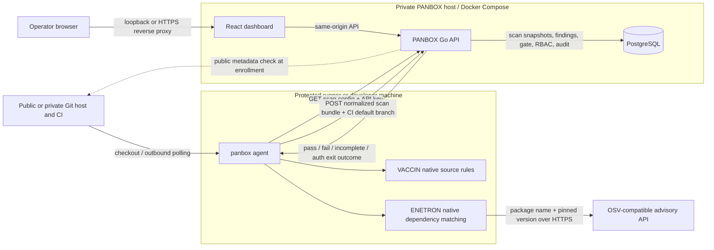
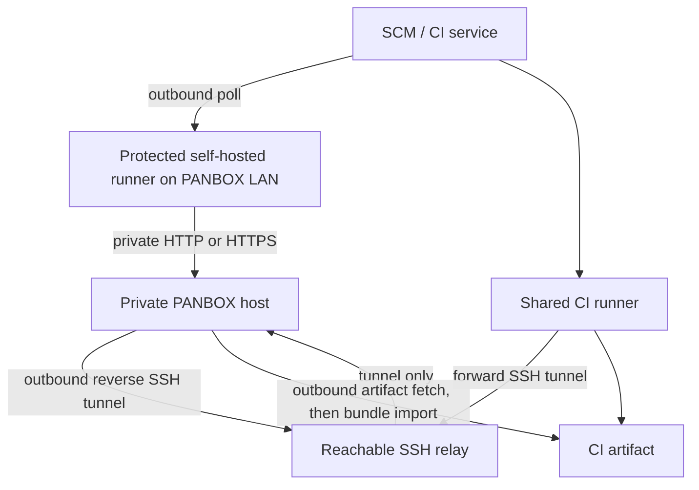

# PANBOX architecture

This diagram describes the beta implementation. The dashboard is a small self-hosted control plane; scan work runs on a separate machine or CI runner. A GitHub, GitLab, Bitbucket, Azure Repos, Gitea, or other Git host can provide the checkout. PANBOX authorizes uploads with a PANBOX project ID, an API key with `scans:write`, and repository access.

## What crosses each boundary

Repository enrollment records the provider, SCM path, HTTPS origin, owner label, and default branch source (`auto`, `ci_pending`, `ci`, or `manual`). The metadata preflight uses an exact-host allowlist for self-hosted SCM. An API key may be project-scoped or valid across its owner's allowed projects; archived projects block upload and their project-bound keys are revoked. The VACCIN runner loads optional repository-local `.panbox/rules.json` with bounded Go regular expressions; a malformed file fails the module. Source stays on the runner. The API stores normalized findings and occurrences, then calculates branch state from the latest complete scan of the finding's module. Recast and disposition histories create new gate revisions without rewriting raw evidence. Only active, open findings contribute to posture totals; resolved findings remain queryable.

1. Before the first CI run, an operator tests SCM connectivity during enrollment. Public metadata supplies the default branch. Private or unreachable metadata leaves `ci_pending`; the first authenticated job can supply the default branch from CI metadata even while scanning a feature branch. Self-managed Git hosts need their exact HTTPS host in `PANBOX_SCM_ALLOWED_HOSTS`. The API creates a PANBOX project ID; an authorized manager creates an API key with `scans:write`. Owner is display metadata. PANBOX never clones source or auto-enrolls from uploads.
2. The agent checks selected source patterns with VACCIN and pinned dependency manifests with ENETRON. ENETRON sends **package names and versions** to the configured OSV-compatible advisory API over HTTPS. It does not send source files to that advisory endpoint. The alpha needs that advisory API for ENETRON; `--offline` suppresses dashboard upload only.
3. Before an online scan, the agent sends `GET /v1/repos/{project-id}/scan-config` with `Authorization: Bearer <api-key>`. The server checks `scans:write`, optional key project scope, key owner membership or Admin, and project active state. Offline scans skip this fetch and are checked when imported.
4. The agent sends a normalized JSON bundle to `POST /v1/scans` with the same header. It contains repository/branch/commit identity, module status, rule IDs, severities, paths/lines, and short messages. It does not contain raw source snippets. The server checks module permissions again, writes the snapshot, and returns a gate result. A partial or error scan is unverified and does not replace the last successful posture.
5. The Go API stores scan policies, scans, findings, severity recast history, gate revisions, roles/permissions, key hashes, and audit events in PostgreSQL. Operators configure scan policy in Repositories, recast findings in Findings, and export filtered CSV/JSON/PDF from Reports. A recast updates effective severity on occurrences and recalculates affected gate revisions using each scan's original threshold; raw severity remains intact.
6. The browser reaches the dashboard on loopback by default. Remote browser access needs a private route or an HTTPS reverse proxy. PostgreSQL should remain private. A local `panbox mcp` stdio process can expose read-only API data to an MCP host using a scoped access key.

Each uploaded bundle carries its current branch and optionally the SCM default branch from trusted CI metadata. Feature branches appear separately without reenrollment. The enrolled default branch drives Overview posture; when enrollment was `ci_pending`, CI metadata establishes that baseline without assuming the scanned branch is default. Later CI metadata refreshes CI-sourced defaults; a manual override remains authoritative. Runner-to-PANBOX connectivity and API key authorization are checked separately through `/readyz` and `/v1/repos/{id}/scan-config` from the runner.

## Public CI to a dashboard without a public IP

| Mode | Where the agent runs | Inbound port on PANBOX host | Gate in the CI job | Current automation |
|---|---|---|---|---|
| Local protected runner | Inside LAN/private network | None from the internet | Synchronous | GitHub Actions and GitLab examples |
| SSH relay | Shared CI runner | None from the internet; outbound reverse tunnel | Synchronous | GitLab example; topology works with other SCM CI |
| Artifact pull/import | CI runner produces bundle; local host imports | None | Asynchronous only | GitLab `relay-pull`; other SCM artifacts need a provider download step before generic `--bundle` import |

The SSH relay is an internet-reachable intermediary, not a public PANBOX endpoint. It needs pinned host keys and restricted identities. A local runner is the simplest path when it can reach both the SCM over outbound HTTPS and PANBOX over the private network. The artifact path is useful when neither CI nor a relay can connect to PANBOX, but it cannot block the originating CI pipeline based on the later dashboard gate.

## Deployment boundary and resource behavior

`deploy/docker-compose.yml` runs the Go server and PostgreSQL. The server serves the built React UI and API; it does not invoke the agent. Each CI job can fetch a pinned, agent-only binary from GitHub Releases into its workspace, verify `SHA256SUMS`, scan, and discard the binary with the job. The dashboard host does not distribute or install agent binaries. Server and database bind to host loopback by default. The 2 GB host target remains a sizing hypothesis, not a measured production guarantee; benchmark both the dashboard and runner with representative repositories and scan bundles.

The alpha supports selected first-party source-pattern rules for Java, JavaScript/TypeScript, Python, PHP, and Go. ENETRON reads npm `package-lock.json` v2/v3, pinned Python `requirements.txt`, Go `go.mod`, Maven `pom.xml`, Gradle `gradle.lockfile`, and PHP `composer.lock`; it matches package coordinates and versions to OSV advisory data. Maven properties and parent-POM inheritance are not resolved, so dependencies without an explicit or local dependency-management version are skipped. This is narrow pilot coverage, not full AST/taint analysis or a measured false-positive rate. RIDER secret scanning and TESLA IaC scanning are roadmap items. See the [English guide](product-guide-en.md) and [Indonesian guide](product-guide-id.md) for setup, RBAC, and operator steps.

## Codebase map

| Path | Responsibility |
|---|---|
| `cmd/panbox` | Single portable agent binary: scan, config fetch, bundle upload, artifact import, and read-only MCP stdio bridge |
| `internal/scanner` | Native VACCIN/ENETRON detection and normalized finding data |
| `internal/core` | Stable IDs, fingerprints, severity gate, baseline comparison |
| `internal/server` | HTTP auth/RBAC, repository policy, scan ingestion, recast, PDF/CSV/JSON export, audit |
| `migrations` | Idempotent PostgreSQL schema updates applied on server start in numeric order |
| `web/src` | React dashboard, including triage, scan policy, reports, and MCP setup guidance |
| `deploy` | Docker Compose and provider-specific CI/network examples |
