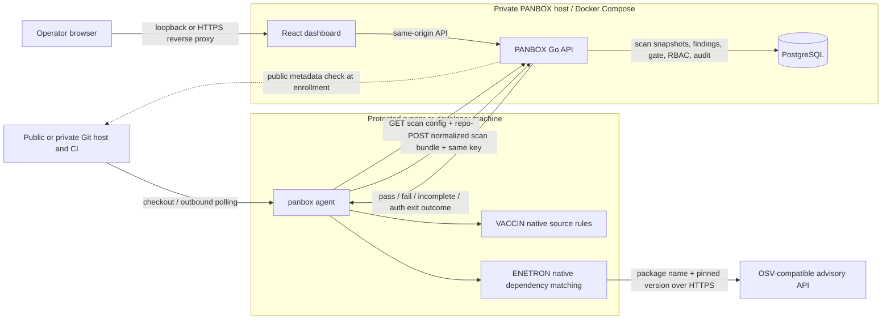
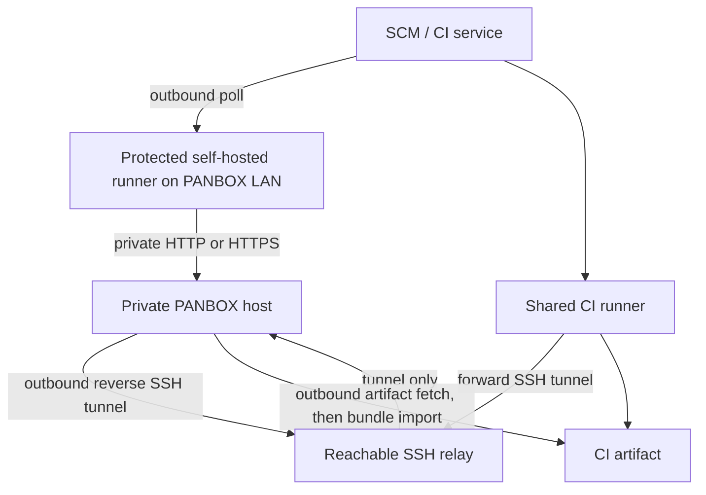

# PANBOX architecture

This diagram describes the alpha implementation. The dashboard is a small self-hosted control plane; scan work runs on a separate machine or CI runner. A GitHub, GitLab, Bitbucket, Azure Repos, Gitea, or other Git host can provide the checkout. PANBOX authorizes uploads through its own internal repository ID and a repository-bound scan key.

## What crosses each boundary

1. Before the first CI run, an operator tests SCM connectivity during enrollment. From the PANBOX host, the API reads public provider metadata and detects the default branch; it does not clone source. Private or unreachable metadata requires an explicit default branch and remains marked `manual_required`. Self-managed Gitea and generic Git HTTPS hosts need the exact host in `PANBOX_SCM_ALLOWED_HOSTS`. The API creates a separate internal repository ID, and an authorized key manager issues a scan key bound to it. Owner is only display metadata. The runner later obtains a Git checkout through its SCM's normal CI flow. This runner-to-SCM check is separate from dashboard-to-SCM metadata reachability. PANBOX does not auto-enroll from uploads or run scanner jobs.
2. The agent checks selected source patterns with VACCIN and pinned dependency manifests with ENETRON. ENETRON sends **package names and versions** to the configured OSV-compatible advisory API over HTTPS. It does not send source files to that advisory endpoint. The alpha needs that advisory API for ENETRON; `--offline` suppresses dashboard upload only.
3. Before an online scan, the agent sends `GET /v1/repos/{internal-id}/scan-config` with `Authorization: Bearer <scan-key>`. It reads whether scanning is enabled, which modules may run, and the gate threshold. The server validates the key against the internal repository ID. Offline scans skip this fetch and are checked when imported.
4. The agent sends a normalized JSON bundle to `POST /v1/scans` with the same header. It contains repository/branch/commit identity, module status, rule IDs, severities, paths/lines, and short messages. It does not contain raw source snippets. The server checks module permissions again, writes the snapshot, and returns a gate result. A partial or error scan is unverified and does not replace the last successful posture.
5. The Go API stores scan policies, scans, findings, severity recast history, gate revisions, roles/permissions, key hashes, and audit events in PostgreSQL. Operators configure scan policy in Repositories, recast findings in Findings, and export filtered CSV/JSON/PDF from Reports. A recast updates effective severity on occurrences and recalculates affected gate revisions using each scan's original threshold; raw severity remains intact.
6. The browser reaches the dashboard on loopback by default. Remote browser access needs a private route or an HTTPS reverse proxy. PostgreSQL should remain private. A local `panbox mcp` stdio process can expose read-only API data to an MCP host using a scoped access key.

Each uploaded bundle carries its branch; new feature branches appear as separate scan/report identities without enrollment. The enrolled default branch drives Overview posture. Only a verified SCM recheck refreshes that baseline; a feature branch upload never changes it. Runner-to-PANBOX connectivity and scan-key authorization are checked separately through `/readyz` and `/v1/repos/{id}/scan-config` from the runner.

## Public CI to a dashboard without a public IP

| Mode | Where the agent runs | Inbound port on PANBOX host | Gate in the CI job | Current automation |
|---|---|---|---|---|
| Local protected runner | Inside LAN/private network | None from the internet | Synchronous | GitHub Actions and GitLab examples |
| SSH relay | Shared CI runner | None from the internet; outbound reverse tunnel | Synchronous | GitLab example; topology works with other SCM CI |
| Artifact pull/import | CI runner produces bundle; local host imports | None | Asynchronous only | GitLab `relay-pull`; other SCM artifacts need a provider download step before generic `--bundle` import |

The SSH relay is an internet-reachable intermediary, not a public PANBOX endpoint. It needs pinned host keys and restricted identities. A local runner is the simplest path when it can reach both the SCM over outbound HTTPS and PANBOX over the private network. The artifact path is useful when neither CI nor a relay can connect to PANBOX, but it cannot block the originating CI pipeline based on the later dashboard gate.

## Deployment boundary and resource behavior

`deploy/docker-compose.yml` runs the Go server and PostgreSQL. The server serves the built React UI and API; it does not invoke the agent. Each CI job can fetch a pinned, agent-only binary from GitHub Releases into its workspace, verify `SHA256SUMS`, scan, and discard the binary with the job. The dashboard host does not distribute or install agent binaries. Server and database bind to host loopback by default. The 2 GB host target remains a sizing hypothesis, not a measured production guarantee; benchmark both the dashboard and runner with representative repositories and scan bundles.

The alpha supports only selected source rules and pinned npm/PyPI/Go manifests. RIDER secret scanning and TESLA IaC scanning are roadmap items. See the [English guide](product-guide-en.md) and [Indonesian guide](product-guide-id.md) for setup, RBAC, and operator steps.

## Codebase map

| Path | Responsibility |
|---|---|
| `cmd/panbox` | Single portable agent binary: scan, config fetch, bundle upload, artifact import, and read-only MCP stdio bridge |
| `internal/scanner` | Native VACCIN/ENETRON detection and normalized finding data |
| `internal/core` | Stable IDs, fingerprints, severity gate, baseline comparison |
| `internal/server` | HTTP auth/RBAC, repository policy, scan ingestion, recast, PDF/CSV/JSON export, audit |
| `migrations` | Idempotent PostgreSQL schema updates applied on server start in numeric order |
| `web/src` | React dashboard, including triage, scan policy, reports, and MCP setup guidance |
| `deploy` | Docker Compose and provider-specific CI/network examples |
