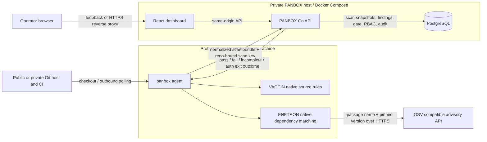
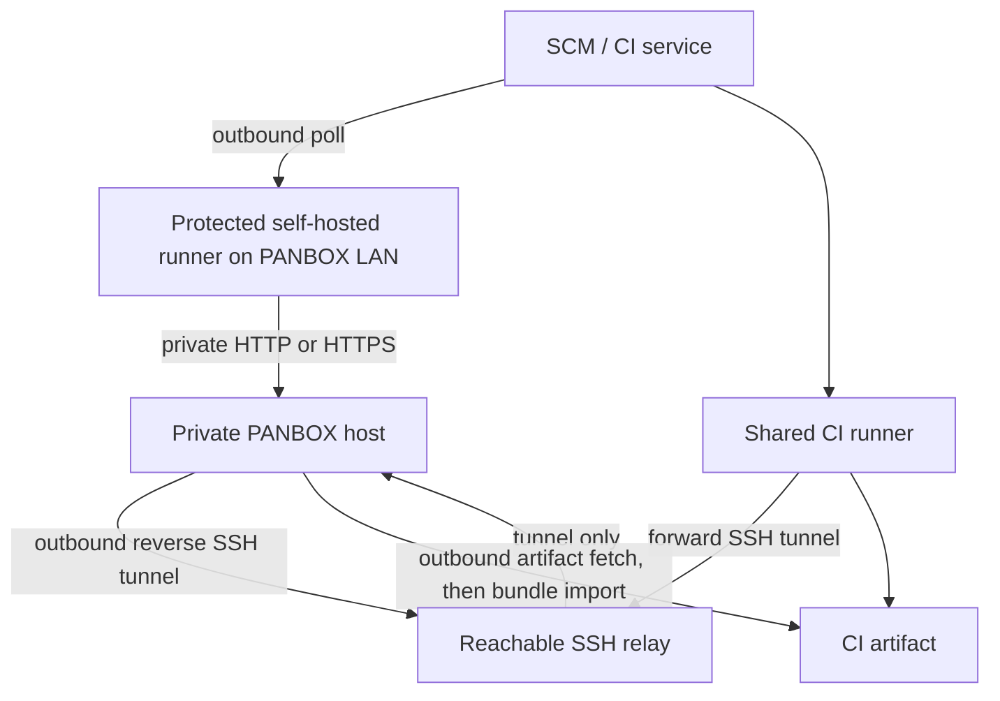

# PANBOX architecture

This diagram describes the alpha implementation. The dashboard is a small self-hosted control plane; scan work runs on a separate machine or CI runner. A GitHub, GitLab, Bitbucket, Azure Repos, Gitea, or other Git host can provide the checkout. PANBOX authorizes uploads through its own internal repository ID and a repository-bound scan key.

## What crosses each boundary

1. The runner obtains a Git checkout through its SCM's normal CI flow. The PANBOX server does not clone source or run scanner jobs.
2. The agent checks selected source patterns with VACCIN and pinned dependency manifests with ENETRON. ENETRON sends **package names and versions** to the configured OSV-compatible advisory API over HTTPS. It does not send source files to that advisory endpoint. The alpha needs that advisory API for ENETRON; `--offline` suppresses dashboard upload only.
3. The agent sends a normalized JSON bundle to `POST /v1/scans`. It contains repository/branch/commit identity, module status, rule IDs, severities, paths/lines, and short messages. It does not contain raw source snippets. A repository-bound scan key authenticates the upload; the server checks the internal repository ID against the key.
4. The Go API writes scans, findings, gate results, roles/permissions, key hashes, and audit events to PostgreSQL. The dashboard reads these through the API. A partial or error scan is unverified and does not replace the last successful posture.
5. The browser reaches the dashboard on loopback by default. Remote browser access needs a private route or an HTTPS reverse proxy. PostgreSQL should remain private.

## Public CI to a dashboard without a public IP

| Mode | Where the agent runs | Inbound port on PANBOX host | Gate in the CI job | Current automation |
|---|---|---|---|---|
| Local protected runner | Inside LAN/private network | None from the internet | Synchronous | GitHub Actions and GitLab examples |
| SSH relay | Shared CI runner | None from the internet; outbound reverse tunnel | Synchronous | GitLab example; topology works with other SCM CI |
| Artifact pull/import | CI runner produces bundle; local host imports | None | Asynchronous only | GitLab `relay-pull`; other SCM artifacts need a provider download step before generic `--bundle` import |

The SSH relay is an internet-reachable intermediary, not a public PANBOX endpoint. It needs pinned host keys and restricted identities. A local runner is the simplest path when it can reach both the SCM over outbound HTTPS and PANBOX over the private network. The artifact path is useful when neither CI nor a relay can connect to PANBOX, but it cannot block the originating CI pipeline based on the later dashboard gate.

## Deployment boundary and resource behavior

`deploy/docker-compose.yml` runs the Go server and PostgreSQL. The server serves the built React UI and API; it does not invoke the agent. Each CI job can fetch a pinned, agent-only binary from GitHub Releases into its workspace, verify `SHA256SUMS`, scan, and discard the binary with the job. The dashboard host does not distribute or install agent binaries. Server and database bind to host loopback by default. The 2 GB host target remains a sizing hypothesis, not a measured production guarantee; benchmark both the dashboard and runner with representative repositories and scan bundles.

The alpha supports only selected source rules and pinned npm/PyPI/Go manifests. RIDER secret scanning and TESLA IaC scanning are roadmap items. See the [English guide](product-guide-en.md) and [Indonesian guide](product-guide-id.md) for setup, RBAC, and operator steps.
